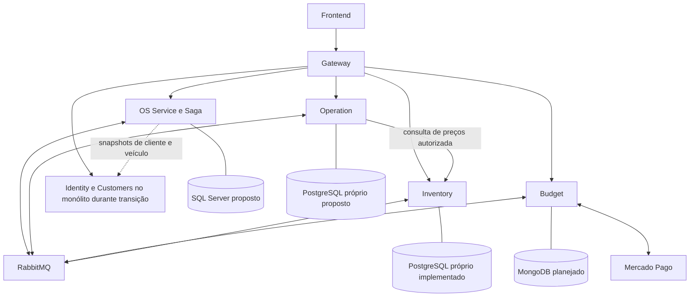
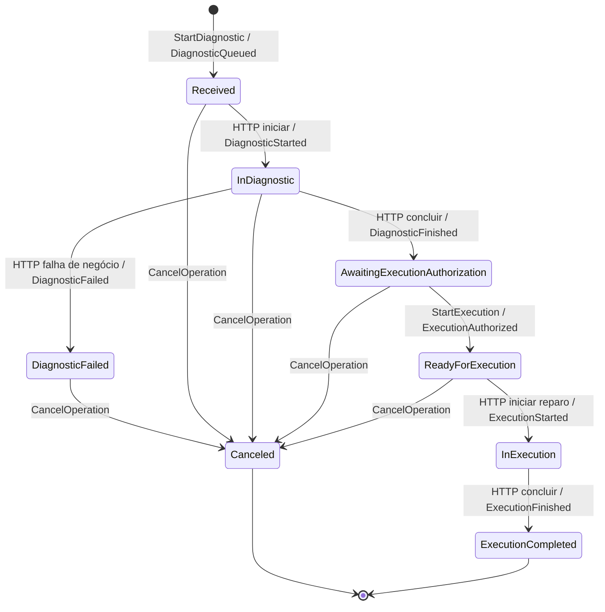

# Diagramas da arquitetura alvo

**Status:** Proposed. Não representam infraestrutura já implantada.

## Componentes



A seta OS -> monólito representa consulta HTTP, nunca banco. Nenhum novo acesso síncrono ao monólito deve virar cadeia obrigatória para cada atualização operacional.

## Caminho feliz com estoque

```mermaid
sequenceDiagram
    actor Mec as Mecânico
    participant OS as OS e Saga
    participant OP as Operation
    participant BI as Budget
    participant INV as Inventory
    OS->>OP: StartDiagnostic
    OP-->>OS: DiagnosticQueued
    Mec->>OP: iniciar diagnóstico (HTTP)
    OP-->>OS: DiagnosticStarted
    Mec->>OP: concluir diagnóstico (HTTP, itens)
    OP->>INV: consultar preços de peças/insumos (HTTP)
    INV-->>OP: preços atuais
    OP-->>OS: DiagnosticFinished (snapshot)
    OS->>BI: GenerateBudget
    BI-->>OS: BudgetGenerated / BudgetApproved
    OS->>BI: RequestPayment
    BI-->>OS: PaymentConfirmed
    OS->>INV: ReserveStock
    INV-->>OS: StockReserved
    OS->>OP: StartExecution (snapshot aprovado)
    OP-->>OS: ExecutionAuthorized
    Mec->>OP: iniciar reparo (HTTP)
    OP-->>OS: ExecutionStarted
    Mec->>OP: registrar serviços e concluir (HTTP)
    OP-->>OS: ExecutionFinished
    OS->>INV: ConsumeStock
    INV-->>OS: StockConsumed
    Note over OS: OS Finalized; entrega ainda é ação própria
```

Setas entre serviços, exceto consulta de preços indicada, representam RabbitMQ. Budget aciona Mercado Pago e só confirma após verificação; passos financeiros são simplificados no desenho.

## Máquina local Operation alvo



CancelOperation sem agregado cria tombstone Canceled. Cancelamento em InExecution/ExecutionCompleted responde rejeição. O enum atual ainda é o do primeiro incremento e não implementa esta máquina.

## Cancelamento seguro

```mermaid
sequenceDiagram
    participant OS as Saga
    participant OP as Operation
    participant INV as Inventory
    participant BI as Budget
    OS->>OP: CancelOperation
    alt cancelamento vence antes do reparo
        OP-->>OS: OperationCanceled (fence persistido)
        OS->>INV: ReleaseStock (se aplicável)
        INV-->>OS: StockReleased
        OS->>BI: RefundPayment / CancelBudget (se aplicável)
        BI-->>OS: confirmações
        Note over OS: somente agora OS Canceled
    else reparo físico já começou
        OP-->>OS: OperationCancellationRejected
        Note over OS: RecoveryRequired; preservar reserva e reconciliar
    end
```
