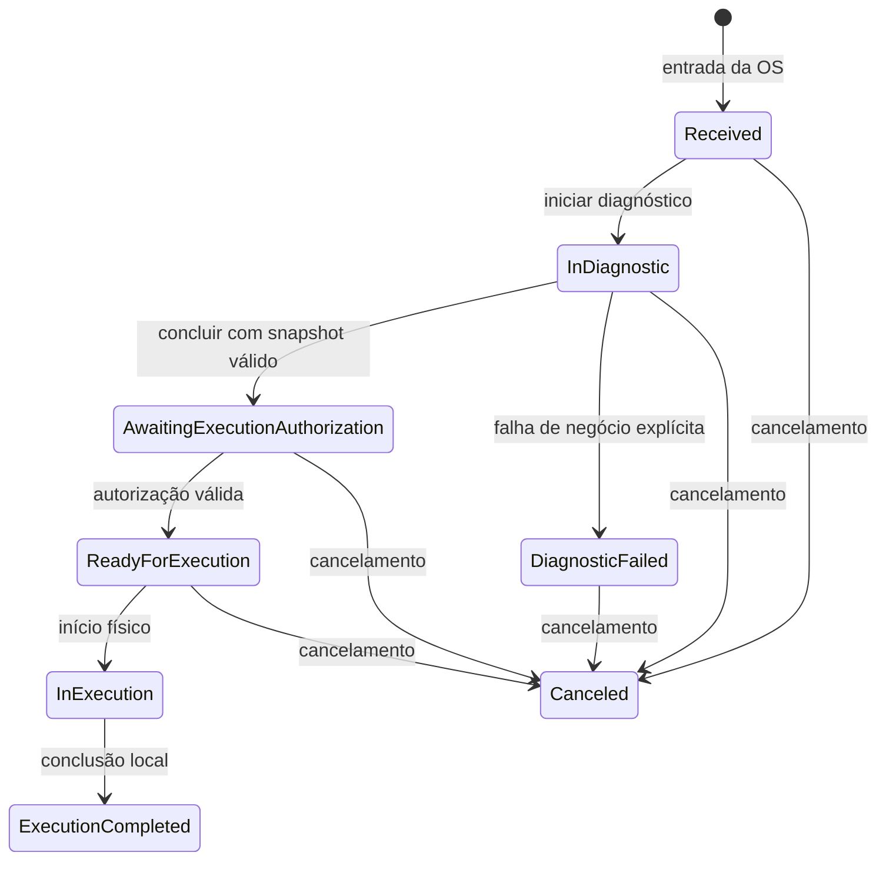

# Passo 2 — modelo operacional interno

Implementação em 28/10/2026. **Escopo:** domínio e adaptação mínima das assinaturas da aplicação inicial. **Não é contrato wire homologado nem serviço integrado.** Passo 3 continua reservado a casos de uso completos, consultas e resolução de preços por portas.

## Modelo implementado

| Tipo | Papel |
|---|---|
| WorkOperation | Agregado identificado pela OS, com veículo, código legível opcional, DiagnosticId estável, atividade, versão, timestamps e auditoria |
| RequestedJob / RequestedPart | Linhas solicitadas na abertura, com identidade de linha distinta do cadastro; peças preservam quantidade inteira |
| DiagnosticConsumable | Insumo informado no diagnóstico com quantidade decimal positiva |
| DiagnosticLine / DiagnosticSnapshot | Snapshot imutável de itens/preços autoritativos, data e identificação da política de preço; soma de totais com overflow verificado |
| ApprovedJob | Relação explícita BudgetJobId -> DiagnosticLineId; não presumir que linha do Budget é igual ao JobId de catálogo |
| ExecutionAuthorization | Orçamento/revisão 1, autorização original, snapshot exato e mapeamento completo das linhas Labor |
| JobProgress | BudgetJobId, DiagnosticLineId, CatalogJobId e data/autor da execução |
| OperationHistory | Ação, versão, estado, autor, data e identidade do objeto da ação quando aplicável |

Fontes: [WorkOperation](../../src/Operation.Domain/WorkOperation.cs), [itens de entrada](../../src/Operation.Domain/RequestedItems.cs), [snapshot](../../src/Operation.Domain/DiagnosticSnapshot.cs), [autorização](../../src/Operation.Domain/ExecutionAuthorization.cs).

## Estados e efeitos

- Deactivate é soft-delete local em Received/InDiagnostic: mantém estado para auditoria, IsActive=false e bloqueia trabalho. Não equivale à rejeição financeira.
- CreateCanceled cria tombstone sem inventar veículo, catálogo ou diagnóstico. Persistir sua unicidade por OS e evitar recriação em outro processo exigem repositório/inbox posteriores.
- CancelOperation idempotente não duplica histórico; após início físico/conclusão, rejeita rollback.
- AuthorizeExecution aceita apenas conteúdo idêntico ao diagnóstico local e mapeamento de todas as linhas Labor. Repetir os mesmos termos não troca a autorização original nem reinicia uma operação em curso/concluída. Dados divergentes falham.
- StartExecution só inicia fisicamente uma operação ReadyForExecution.
- ExecuteJob usa BudgetJobId, registra autor/data e rejeita segunda execução da mesma linha, preservando o guard legado. Idempotência da intenção HTTP/mensagem virá na aplicação/journal.
- FinalizeExecution não exige todas as linhas marcadas, preservando a regra observada na fase 3. Não afirma consumo de estoque nem finalização/entrega global.

O enum local foi alterado e seus números não devem ser persistidos/intercambiados como enum global da OS. Ainda não há banco Operation nem migration implantada; um adapter futuro deve mapear explicitamente estados e histórico. Não serializar o agregado diretamente como mensagem.

## Invariantes e segurança contra mutação parcial

- OS/veículo/DiagnosticId e IDs de linha/catálogo válidos; pelo menos um serviço e no máximo 200 linhas iniciais. O código da OS é opcional e positivo quando fornecido, sem nova sequência local.
- IDs de linha únicos entre serviços/peças/consumíveis; o mesmo item de catálogo pode ocorrer em linhas diferentes, com progresso independente.
- Part aceita quantidade inteira positiva; Consumable até três casas decimais positivas; Labor uma unidade por linha. Limite/precisão seguem a baseline local e ainda precisam refletir o contrato externo aceito.
- CompleteDiagnostic preserva todos os serviços/peças inicialmente recebidos e os insumos informados. Não aceita omissões, itens extra, troca de tipo, quantidade, catálogo ou identidade da linha. A precificação fica dentro da janela de diagnóstico e o snapshot deve ter DiagnosticId correto.
- Coleções são copiadas na entrada e expostas como somente leitura. Itens e snapshots não podem ser alterados após criação por setters públicos.
- Validações ocorrem antes de alterar agregado, histórico ou progresso. Timestamps são normalizados em UTC, não podem regredir e cada alteração efetiva incrementa a versão e registra uma ação.
- Mudar veículo é permitido antes da conclusão do diagnóstico, mesmo durante InDiagnostic; depois fica bloqueado. Propagação/ordenação de atualização da OS ainda requer caso de uso/contrato.

## Valores financeiros: limite deliberado

DiagnosticLine recebe UnitPriceCents e LineTotalCents não negativos de uma política de preço autoritativa; DiagnosticSnapshot exige PricingPolicyId e soma os totais de linha com verificação de overflow. **Não calcula silenciosamente quantity*unitPrice para os insumos.**

Isso evita alterar a semântica da fase 3 (que somava PriceCents dos insumos) sem acordo com Budget. O modelo preserva ambos os valores e a origem lógica da política, não prova que o preço veio de um serviço confiável. No passo 3, a aplicação deverá selecionar/validar a política por porta e rejeitar preço ausente, sem fallback zero. Antes da integração real, grupo deve fixar fórmula/arredondamento e wire format. Não usar estes tipos como entrada livre de preço do navegador.

## Adaptação de compilação da aplicação existente

OperationService.Receive agora recebe os dados necessários à construção do agregado. CompleteDiagnostic recebe snapshot/insumos; AuthorizeExecution substitui bool stockReserved; StartExecution é ação separada; CancelOperation substitui a chamada técnica antiga. A fila existente foi adaptada aos novos estados, excluindo espera comercial, falha, inativas e terminais, com ordem InExecution -> ReadyForExecution -> InDiagnostic -> Received, antiguidade e ID.

Esses ajustes são necessários para compilar e regredir o núcleo com a nova API de domínio. **Não concluem o passo 3:** serviço ainda usa evento interno genérico, recebimento duplicado retorna conflito, não possui consulta completa/paginação, precificação por portas, journal ou unidade de trabalho isolada. CancelOperation da aplicação inicial só carrega operação existente; criação de tombstone pela aplicação será feita no passo 3. Nenhum consumer está publicado.

## Testes por responsabilidade

- [IntakeTests](../../tests/Operation.Tests/IntakeTests.cs): entrada, coleções defensivas, identidades, veículo e datas.
- [SnapshotTests](../../tests/Operation.Tests/SnapshotTests.cs): quantidade/tipos, preços, cópia de listas, total fornecido e overflow.
- [DiagnosticTests](../../tests/Operation.Tests/DiagnosticTests.cs): paridade dos itens, falhas, diagnóstico/data, rejeição sem alteração parcial.
- [ExecutionTests](../../tests/Operation.Tests/ExecutionTests.cs): autorização exata/repetida, mapeamento de linha, progresso independente e conclusão.
- [CancellationTests](../../tests/Operation.Tests/CancellationTests.cs): atividade, cancelamento, tombstone e ordem dos atos de início/cancelamento.
- [QueueTests](../../tests/Operation.Tests/QueueTests.cs): fila e desempates.
- [OperationTests](../../tests/Operation.Tests/OperationTests.cs): regressão das assinaturas da aplicação inicial, sem declarar transação de banco.

Os testes antigos de 19 casos foram reorganizados/evoluídos, não simplesmente somados. A matriz/evidência do passo 1 preserva os nomes/hashes da baseline histórica; os testes atuais e os resultados do passo 2 são a referência para a implementação nova.

## O que continua posterior

Portas de preço e queries/casos de uso completos (passo 3), política financeira final, repositório e cópias isoladas/rehidratação, concorrência em banco, migrations, inbox/outbox, contratos wire, RabbitMQ, autenticação, API e BDD. Não houve alteração em app/Budget/Inventory, publicação ou deploy.

## Evolução posterior

O [passo 3](STEP_3_APPLICATION.md) implementou as portas/casos de uso/queries e isolamento local previstos aqui. Os limites mencionados para Application no texto acima são o histórico do checkpoint 2; persistência/rede continuam posteriores.
